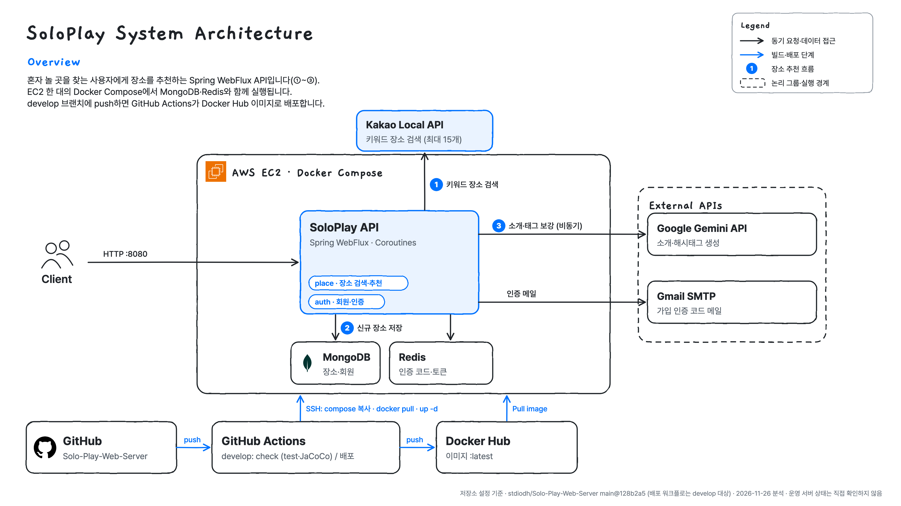

# SoloPlay System Architecture

[SVG 원본](./architecture.svg)

## 구조 요약

- Kakao 장소 검색 결과를 MongoDB에 저장하고, Gemini로 소개·해시태그를 비동기 보강하는 Spring WebFlux(Kotlin Coroutines) API입니다.
- 회원 인증 코드·가입 증표·Refresh Token은 Redis에 두고, 인증 코드는 Gmail SMTP로 보냅니다.
- 배포 설정은 EC2 한 대의 Docker Compose로 API, MongoDB, Redis 컨테이너를 띄웁니다. Nginx는 없고 API 8080 포트를 그대로 엽니다.
- `develop`에 push하면 GitHub Actions가 이미지를 Docker Hub에 올리고 SSH로 EC2에서 교체합니다.

## 조사 기준

| 항목 | 값 |
| --- | --- |
| 분석일 | 2026-11-26 |
| 저장소 | [stdiodh/Solo-Play-Web-Server](https://github.com/stdiodh/Solo-Play-Web-Server) |
| 확인한 커밋 | `main` [`128b2a5`](https://github.com/stdiodh/Solo-Play-Web-Server/commit/128b2a5a8b2ff27a230a39293a29748e672b4f7a) |
| 대상 환경 | `deploy-dev.yml`이 배포하는 Dev 구성 (저장소 설정 기준) |
| 운영 서버 | 직접 확인하지 않음 |

## 근거표

`B` = `https://github.com/stdiodh/Solo-Play-Web-Server/blob/128b2a5a8b2ff27a230a39293a29748e672b4f7a`

| 도면의 구성요소·연결·경계 | 의미 | 근거 | 환경 | 확인 상태 |
| --- | --- | --- | --- | --- |
| AWS EC2 · Docker Compose | 배포 대상 호스트와 컨테이너 묶음 | [deploy-dev.yml](https://github.com/stdiodh/Solo-Play-Web-Server/blob/128b2a5a8b2ff27a230a39293a29748e672b4f7a/.github/workflows/deploy-dev.yml) (`AWS_HOST`로 scp·ssh), [docker-compose.yml](https://github.com/stdiodh/Solo-Play-Web-Server/blob/128b2a5a8b2ff27a230a39293a29748e672b4f7a/docker-compose.yml) | Dev | 코드·설정 확인 |
| Client → SoloPlay API | 8080 포트 직접 공개 | [docker-compose.yml](https://github.com/stdiodh/Solo-Play-Web-Server/blob/128b2a5a8b2ff27a230a39293a29748e672b4f7a/docker-compose.yml) (`8080:8080`) | Dev | 코드·설정 확인 |
| SoloPlay API | Spring WebFlux · Kotlin Coroutines | [build.gradle.kts](https://github.com/stdiodh/Solo-Play-Web-Server/blob/128b2a5a8b2ff27a230a39293a29748e672b4f7a/build.gradle.kts) | Dev | 코드·설정 확인 |
| API → MongoDB | 장소·회원 저장 | [application.yml](https://github.com/stdiodh/Solo-Play-Web-Server/blob/128b2a5a8b2ff27a230a39293a29748e672b4f7a/src/main/resources/application.yml), [docker-compose.yml](https://github.com/stdiodh/Solo-Play-Web-Server/blob/128b2a5a8b2ff27a230a39293a29748e672b4f7a/docker-compose.yml) (`depends_on: mongodb`) | Dev | 코드·설정 확인 (URI는 비밀값이라 값 자체는 미확인) |
| API → Redis | 인증 코드·가입 증표·Refresh Token | [RedisConfig.kt](https://github.com/stdiodh/Solo-Play-Web-Server/blob/128b2a5a8b2ff27a230a39293a29748e672b4f7a/src/main/kotlin/com/example/solo_play_web_server/common/config/RedisConfig.kt), [docker-compose.yml](https://github.com/stdiodh/Solo-Play-Web-Server/blob/128b2a5a8b2ff27a230a39293a29748e672b4f7a/docker-compose.yml) (`SPRING_DATA_REDIS_HOST: redis`) | Dev | 코드·설정 확인 |
| API → Kakao Local API | 키워드 장소 검색 | [application.yml](https://github.com/stdiodh/Solo-Play-Web-Server/blob/128b2a5a8b2ff27a230a39293a29748e672b4f7a/src/main/resources/application.yml), `dapi.kakao.com` 호출 코드 | 공통 | 코드·설정 확인 |
| API → Google Gemini API | 장소 소개·태그 보강 | [WebClientConfig.kt](https://github.com/stdiodh/Solo-Play-Web-Server/blob/128b2a5a8b2ff27a230a39293a29748e672b4f7a/src/main/kotlin/com/example/solo_play_web_server/common/config/WebClientConfig.kt), [PlaceEnrichmentService.kt](https://github.com/stdiodh/Solo-Play-Web-Server/blob/128b2a5a8b2ff27a230a39293a29748e672b4f7a/src/main/kotlin/com/example/solo_play_web_server/place/service/PlaceEnrichmentService.kt) | 공통 | 코드·설정 확인 |
| API → Gmail SMTP | 가입 인증 코드 메일 | [application.yml](https://github.com/stdiodh/Solo-Play-Web-Server/blob/128b2a5a8b2ff27a230a39293a29748e672b4f7a/src/main/resources/application.yml) (`smtp.gmail.com`) | 공통 | 코드·설정 확인 |
| GitHub Actions (develop) | `check`(테스트·JaCoCo) | [test-cicd.yml](https://github.com/stdiodh/Solo-Play-Web-Server/blob/128b2a5a8b2ff27a230a39293a29748e672b4f7a/.github/workflows/test-cicd.yml) | CI | 코드·설정 확인 |
| Actions → Docker Hub → EC2 | 이미지 push, compose 복사, pull·up | [deploy-dev.yml](https://github.com/stdiodh/Solo-Play-Web-Server/blob/128b2a5a8b2ff27a230a39293a29748e672b4f7a/.github/workflows/deploy-dev.yml) | CI/CD | 코드·설정 확인 |

## 로고 출처

| 기술·제품 | 사용 파일 | 공식 출처 페이지 | 실제 다운로드 URL·패키지 내 경로 | 확인일 | 원본 SHA-256 |
| --- | --- | --- | --- | --- | --- |
| Amazon EC2 | `assets/logos/aws-ec2.svg` | https://aws.amazon.com/architecture/icons/ | https://d1.awsstatic.com/onedam/marketing-channels/website/public/shared/architecture-icon-release/Icon-package_07312026.5846e92413caa21490223536cc97f1269e44fa92.zip: Architecture-Service-Icons_07312026/Arch_Compute/64/Arch_Amazon-EC2_64.svg | 2026-11-26 | `5a7a0cef7a9f44ccdd544564ce9076abec3024090be0d6454504c49d149ce9ec` |
| MongoDB | `assets/logos/mongodb.svg` | https://www.mongodb.com/company/newsroom/brand-resources | https://brandfolder.com/mongodb/press-kit (linked as 'Download our Media Kit') -> asset mpb3hfbgpkksmnh3bfvb6m3w 'Evergreen - Logomark', attachment 'Evergreen - Logomark.svg' (original fetched via signed storage-us-gcs.bfldr.com URL, which expires) | 2026-11-26 | `4cffb92805e9ad93459b5ba1d7baa7753e23247a78b4091a1079b1f39562009c` |
| GitHub (also for GHCR) | `assets/logos/github.svg` | https://brand.github.com/foundations/logo | https://brand.github.com/GitHub_Logos.zip: GitHub Logos/SVG/GitHub_Invertocat_Black.svg | 2026-11-26 | `693d7abe6f899646cc2e96856723b45e95f71885a54910b2749f6decdf7e1ee1` |

## 확인 필요 사항

- 프론트엔드 저장소와 배포 위치는 이 저장소에서 확인되지 않아 `Client`로만 표시했습니다.
- 배포 워크플로가 `develop` 대상이라 운영(`main`) 배포 구성은 따로 확인되지 않았습니다.
